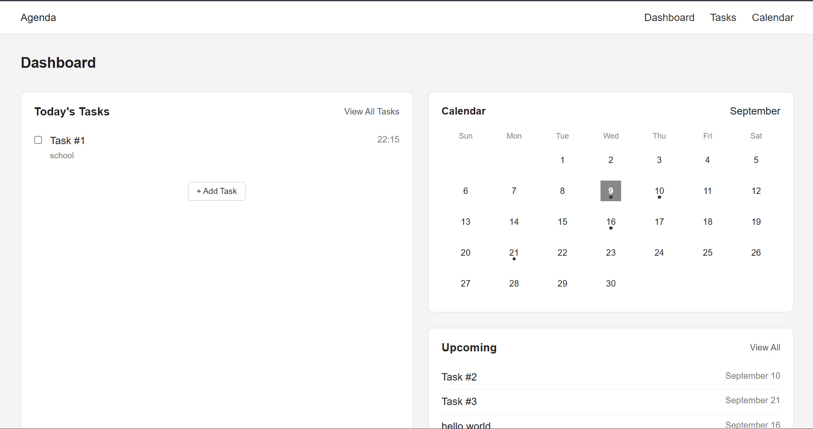
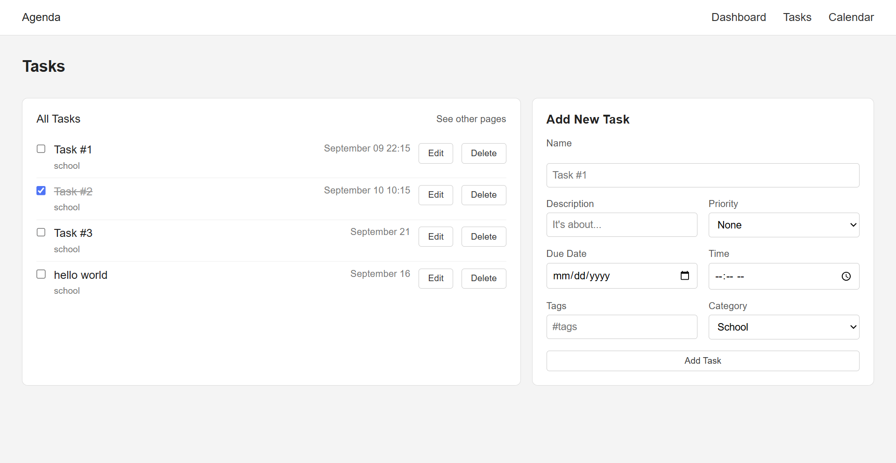

# Agenda — CMSC128 Lab Activity 1 (CRUD)

**Agenda** is a multi-account to-do list web app built for CMSC 128. Each user has a personal to-do list organized into pages (categories), and can create collaborative group lists and add other users to them.

- **Activity 1:** To-do list with create, read, update and delete.
- **Activity 2:** Registration, login, logout, sessions, profile page and password recovery.
- **Activity 3:** User-based access control (UBAC) plus collaborative lists.

## Tech Stack

- **Frontend:** HTML, CSS
- **Templating:** Jinja2 (Flask's built-in templating engine)
- **Backend:** Flask (Python)
- **Database:** SQLite
- **Authentication:** Flask cookie-based sessions, Werkzeug password hashing, itsdangerous signed tokens for password reset
- **Email:** Flask-Mailman (SMTP)

### Why this stack

Flask + SQLite was chosen to emphasize clarity and foundational understanding in web application development. Flask’s lightweight design exposes the essential mechanics of routing, request handling, and response generation without the overhead of a larger framework. SQLite complements this by offering a self‑contained, file‑based database that requires no separate server process, making data interactions transparent and easy to inspect.

This combination provides a complete yet minimal stack: the frontend communicates with Flask, Flask processes and passes data to SQLite, and results are returned directly. By working without heavy abstractions, the project highlights the direct relationship between the application, its database, and the user interface. This approach is particularly well‑suited for a simple to‑do list app, where the data model is straightforward, the scale is modest, and the focus is on mastering CRUD operations and data flow.
### About Jinja2

Jinja2 is the templating engine Flask uses to embed Python-driven logic directly into HTML files. It's what allows `{{ }}` (print a value) and `` (control logic — loops, conditionals, template inheritance) to work inside `.html` templates. In this project, Jinja2 is used for:

- **Template inheritance** (``, ``) — so `dashboard.html` and `tasks.html` share one common page shell instead of duplicating the `<nav>` and `<head>` on every page.
- **Includes** (``) — reusing the nav bar component across pages.
- **Loops** (`...`) — rendering each row returned from a database query as an `<li>`.
- **Conditionals** (`checked`) — conditionally applying attributes/styling based on task data.
- **Variable printing** (`{{ task['name'] }}`) — inserting database values into the rendered HTML.
 
## How to Run Locally

1. **Clone the repository**
    
    ```bash
    git clone https://github.com/strg-ze/cmsc128-Lab1_CRUD_tipon.git
    cd <your-repo-folder>
    git checkout act3-ubac
    ```
    
2. **Set up a virtual environment (recommended)**
    
    ```bash
    python -m venv venv
    venv\Scripts\activate      # Windows
    source venv/bin/activate   # macOS/Linux
    ```
    
3. **Install dependencies**
    
    ```bash
    pip install -r requirements.txt
    ```

4. **Configure environment variables**

    Create a `.env` file (or set these in your shell). Names must match what `routes/config.py` reads.

    ```env
    SECRET_KEY=change-me-to-a-long-random-string
    MAIL_SERVER=smtp.gmail.com
    MAIL_PORT=587
    MAIL_USE_TLS=True
    MAIL_USERNAME=your-address@example.com
    MAIL_PASSWORD=your-app-password
    MAIL_SENDER=your-address@example.com
    ```

    - `SECRET_KEY` signs session cookies and reset tokens. Keep it private and never commit it.
    - With Gmail, `MAIL_PASSWORD` must be an app password, not your normal password.
    - For local testing without SMTP, set `MAIL_BACKEND = "console"` in the config to print emails to the terminal.
    - `RESET_MAX_AGE` (in `routes/config.py`) is the reset link lifetime in seconds.
  
5. **Initialize the database**
    
    ```bash
    python init_db.py
    ```
    
    This creates `database.db` using the schema defined in `schema.sql`.
    
6. **Run the app**
    
    ```bash
    python app.py
    ```
    
7. **Open in browser** Visit `http://localhost:5000`
    

## Routes

### Public

| Method | Route | Description |
| ------ | ----- | ----------- |
| GET | `/` | Landing page (redirects to `/dashboard` if logged in) |
| GET, POST | `/register` | Create an account |
| GET, POST | `/login` | Log in |
| POST | `/logout` | Log out |
| GET, POST | `/forgot-password` | Request a reset link |
| GET, POST | `/reset-password/<token>` | Set a new password using a reset link |

### Login required

| Method and path | Purpose | Ownership check |
|---|---|---|
| `POST /logout` | End the session | login required |
| `GET /dashboard` | Today, upcoming, calendar | joins `list_members` on the session user |
| `GET /profile` | Profile page | login required |
| `POST /profile/details` | Change display name and email | acts on the session user only; email must be unique |
| `POST /profile/password` | Change password | current password re-verified |
| `GET /tasks?mode=&page=&list=&edit=` | Task page, filtered by mode, page, list or task being edited | selected page/list must belong to the user, otherwise 404 |
| `POST /tasks` | Add a task | target list must have the user as a member (404); category must belong to the user (404) |
| `POST /tasks/update/<id>` | Edit a task | `get_task_for_user` (404) |
| `POST /tasks/complete/<id>` | Toggle completed | `get_task_for_user` (404) |
| `POST /tasks/delete/<id>` | Soft delete (`is_visible = 0`) | `get_task_for_user` (404) |
| `POST /tasks/restore/<id>` | Undo delete | `get_task_for_user` (404) |
| `POST /pages/new` | Create a page (category) | acts on the session user |
| `POST /pages/<id>/rename`, `/pages/<id>/delete` | Rename or delete a page | page must belong to the user (404) |
| `POST /lists/new` | Create a group list | creator becomes owner and first member |
| `POST /lists/<id>/rename`, `/delete` | Rename or delete a list | owner only (404 non-member, 403 member) |
| `POST /lists/<id>/members/add`, `/members/<user_id>/remove` | Manage members | owner only; the owner cannot be removed |
| `POST /lists/<id>/leave` | Leave a list | member; the owner cannot leave |

## Features

### From Activity 1 (Tasks)

- Dashboard with today's tasks, upcoming tasks and a calendar view
- Add, edit, delete (soft delete) and complete tasks
- Undo on delete via a toast notification
- Data persistence in SQLite

### Added in Activity 2 (Accounts)

- **Registration and login/logout** with a public landing page
- **Per-user data:** every task query is filtered by the logged-in user's id, so users only see and modify their own tasks
- **Protected pages:** `/dashboard`, `/tasks` and `/profile` require login
- **Profile page:**
  - Update display name and email (email must be unique across accounts)
  - Change password (requires the current password; the new one must differ from it and be confirmed)
  - Success and error feedback through flash messages
  - Unsaved-changes warning if you leave the page with edited fields
- **Password recovery by email** (see below)

#### Session Handling

- On successful login the app stores `user_id` and `display_name` in Flask's `session`. Flask keeps the session in a **signed cookie**, so the browser cannot tamper with it without invalidating the signature. This is why `SECRET_KEY` must be secret.
- The `@login_required` decorator checks for `user_id` in the session on every protected route and redirects to the login page if it is missing.
- Every task query and update includes `AND user_id = ?` with `session["user_id"]`, so one user cannot read or change another user's tasks by guessing ids.
- Logging out clears the session.
- An `after_request` hook (`no_cache_for_logged_in_pages`) adds no-cache headers to logged-in pages, so pressing the browser's back button after logging out does not show cached private content.
- Passwords are never stored in plain text. They are hashed with Werkzeug's `generate_password_hash` and checked with `check_password_hash`.
- If a logged-in user visits `/forgot-password`, they are redirected to their profile instead.

#### Password Recovery

1. **Request:** the user enters their email at `/forgot-password`.
2. **Same response either way:** the page shows the same confirmation whether or not the email exists, so it cannot be used to discover which emails are registered.
3. **Token creation:** if the account exists, the app builds a signed token with `itsdangerous.URLSafeTimedSerializer`. The token contains:
    - the user's id (`uid`)
    - a **fingerprint** of the current password hash (`fp`, the first 16 hex characters of its SHA-256)

    The serializer is signed with `SECRET_KEY` and uses its own salt (`"password-reset"`), so these tokens are useless for anything else signed with the same key. The token is also timestamped.
4. **Email:** a link to `/reset-password/<token>` is sent through Flask-Mailman.
5. **Validation:** when the link is opened, the app rejects the token if any of these is true:
    - the signature is invalid or the token was altered
    - it is older than `RESET_MAX_AGE`
    - the stored fingerprint no longer matches the user's current password hash
6. **Reset:** if the token is valid, the user enters and confirms a new password (minimum 8 characters). The app saves the new hash and redirects to login with a success message.
7. **Single use:** no token table is needed. Changing the password changes the hash, so the fingerprint inside any previously issued link stops matching and the link becomes invalid. The same happens if the user changes their password from the profile page after requesting a reset.

### Activity 3- Access Control (UBAC)
- **Personal tasks:** add, edit, complete, delete (with undo via a toast), organized into pages (categories) you can create, rename and delete.
- **Group lists:** create a list, add members by email, and work on shared tasks. Owners can rename the list, add and remove members, and delete the list. Other members can leave.
- **Access control:** a user can only read or change tasks in lists they belong to. Anything else returns 404 (not found) or 403 (forbidden).

### How Activity 1 and Activity 2 Were Merged

>Activity 2 was initially developed on top of Activity 1 rather than from a separate branch. As a result, when the database schema was updated to include user_id in the tasks table, most merge conflicts involved modifying existing queries to accommodate the new field.

>For Activity 3, the schema was revised again to introduce support for lists. The following section explains how the updated tables relate to one another.

**How the tables relate**

- **Users and lists:** every user gets one hidden *personal* list when they register (`is_personal = 1`). Group lists are other rows in the same table (`is_personal = 0`) with an owner.
- **Membership:** `list_members` holds one row per (list, user). The owner is also a member, and the personal list has only its owner. Every access check reads this table, so personal and group tasks follow the same rule.
- **Tasks:** each task belongs to one list (`list_id`). `user_id` records who created it and is only used for the "Added by" label, not for access.
- **Categories ("pages"):** belong to a user and apply to personal tasks. Group tasks have no category.
- **Normalized:** user details live only in `users`. Other tables reference them by id.
- **Foreign keys** are enforced (`PRAGMA foreign_keys = ON` on every connection):
  - deleting a list deletes its tasks and memberships (`ON DELETE CASCADE`),
  - deleting a page keeps its tasks and clears their category (`ON DELETE SET NULL`).

## Access Control (UBAC)

All checks run on the backend.

**The membership check for tasks** (`get_task_for_user` in `lists/service.py`): a task is returned only if the logged-in user belongs to the list it lives in.

```sql
SELECT t.*, l.is_personal
FROM tasks t
JOIN lists l ON l.id = t.list_id
JOIN list_members m ON m.list_id = l.id
WHERE t.id = ? AND m.user_id = ?      -- task id from the URL, user id from the session
```

If no row comes back, the route calls `abort(404)`. Other helpers work the same way:

| Helper | Checks | Failure |
|---|---|---|
| `get_task_for_user` | user is a member of the task's list | 404 |
| `get_group_list_or_404` | user is a member of this group list | 404 |
| `get_group_list_or_404(owner_only=True)` | user is a member **and** the owner | 404 if not a member, 403 if a member but not the owner |
| `get_own_category_or_404` | the page (category) belongs to the user | 404 |
| `get_tasks_for_view` | every list query joins `list_members` on the logged-in user | other lists never appear |

## Screenshots



